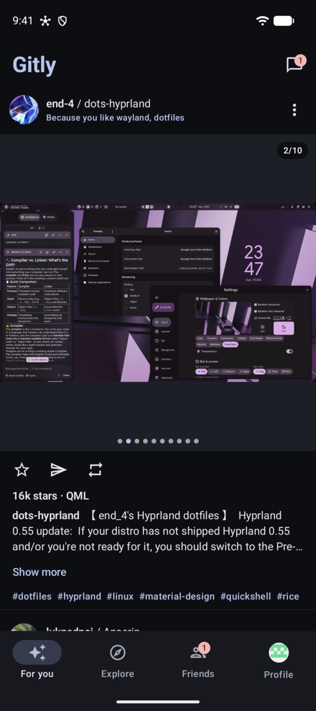
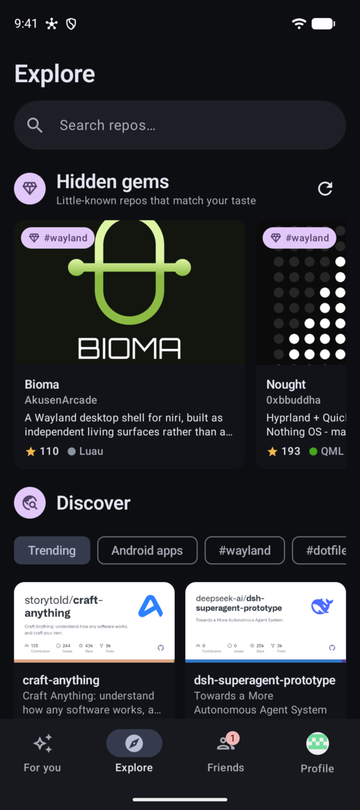
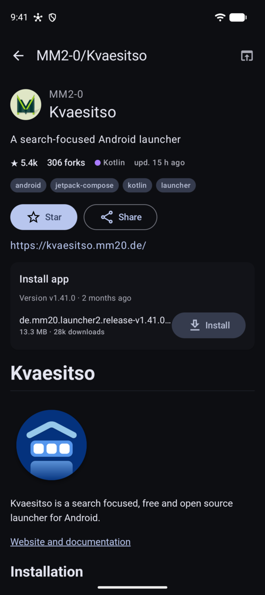
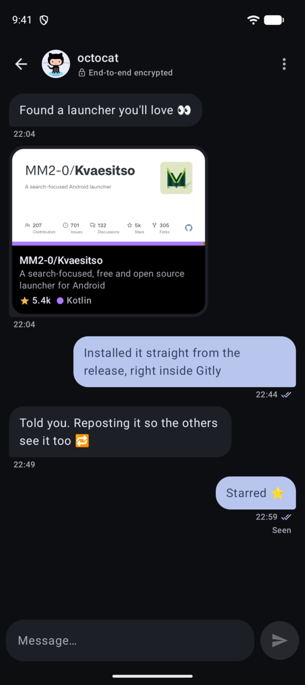
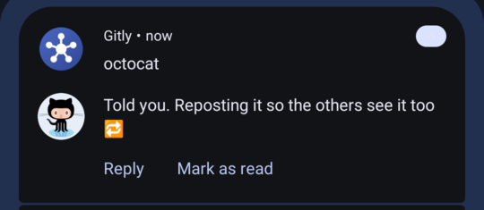
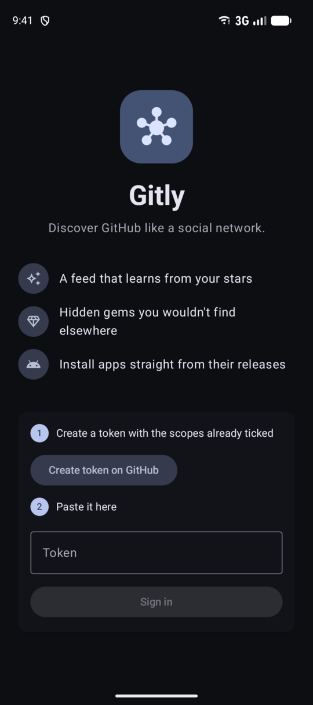
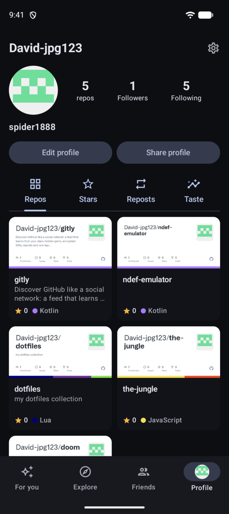

<p align="center">
  
</p>

<h1 align="center">Gitly</h1>

<p align="center">
  <b>Discover GitHub like a social network.</b><br>
  A feed that learns from your stars, hidden gems you'd never find on your own,<br>
  encrypted DMs with your mutual follows, reposts — and one-tap APK installs straight from releases.
</p>

<p align="center">
  
  
  
  
  
</p>

<p align="center">
  
  
  
  
</p>

---

GitHub's own *Explore* page has no real recommendation engine. Gitly turns GitHub into the social app it
could be: an Instagram-style feed of repositories ranked for **you**, a place to share what you find with
friends, and a shortcut from "this looks cool" to "it's installed on my phone".

**There is no Gitly server.** GitHub is the backend (your likes are real stars, your social graph is who
you follow), the recommender runs on your phone, and private messages travel end-to-end encrypted over
public [Nostr](https://nostr.com) relays.

## Features

### 🏠 For you
- Instagram-style posts: a swipeable carousel of the images in each README (badges, QR codes and
  donation banners are filtered out), the README text underneath and a **Show more** toggle.
- **Double-tap to star**, send to a friend, repost, or open the full README.
- Every post tells you *why* it's there: "Because you like wayland, qml", "Starred by @friend",
  "Reposted by @friend"…
- Friends' reposts are mixed into your feed with a ⟲ mark, Instagram style.

### 🧭 Explore
- Search, trending, Android apps and your favourite topics in a two-column grid.
- **Hidden gems**: small (5–600★), active, well documented projects close to your taste that are gaining
  stars fast for their age.

### 📦 One-tap APK install
If a repository's latest release ships an `.apk`, Gitly shows an **Install** card that picks the right
build for your device's ABI. Links to `github.com/owner/repo` can be opened directly in Gitly.

### 💬 Friends & DMs
- Private messages and shared repo cards — **only between mutual follows** (you follow each other on GitHub).
- End-to-end encrypted (NIP-17 / NIP-44 gift wraps); neither GitHub nor the relays can read them.
- Notifications with inline **Reply** and **Mark as read**; instant delivery through
  [UnifiedPush](https://unifiedpush.org) (e.g. ntfy) or a 15-minute background check.
- Read receipts ("Seen"), mute, hide reposts, block (optionally on GitHub too) and report.

<p align="center"></p>
<p align="center"><sub>The conversation with @octocat in the screenshots is demo data.</sub></p>

### 👤 Profiles
- Avatar, bio, repos / followers / following, Repos · Stars · Reposts tabs and your **Taste** profile.
- Follow, message and edit your GitHub profile without leaving the app.
- Settings: multiple accounts, light/dark/system theme, dynamic color, English/Spanish, privacy
  (who can message you, who sees your reposts, read receipts).

<p align="center">
  
  
</p>

## How the recommender works

1. **Features** — each repo becomes a normalized vector of topics, language and description words.
2. **Your taste** — the sum of the repos you starred (+1), opened (+0.3) and dismissed (−1.5), with a
   240-day half-life so your profile follows you as your interests change.
3. **Candidates** — what people you follow star and publish, searches on your strongest topics,
   recently trending projects in your languages, and a light collaborative filter ("people who starred
   what you starred also starred…").
4. **Ranking** — similarity, social signal, co-stars, popularity and freshness, minus penalties for
   repos you've already seen, archived repos and forks; then **MMR** re-ranking so the feed stays diverse.

Everything is computed on-device from the GitHub REST API.

## Privacy by design

| What | Where it lives |
|---|---|
| Stars, follows, profile | Your GitHub account (Gitly only calls the GitHub API) |
| Recommendation profile | Only on your phone |
| Messaging key | Generated on your phone, encrypted with the Android Keystore. Its *public* half is published in a `gitly.json` gist so friends can verify it's really you |
| Messages, private reposts, read receipts | End-to-end encrypted over public Nostr relays |
| Push "doorbell" URL | Shared only with mutual follows, encrypted; the message itself never goes through it |

Public reposts are opt-in (Settings → Privacy → *Who sees my reposts*).

## Install

Grab the APK from [Releases](../../releases) — or, fittingly, open this repository in Gitly and tap **Install**.
Android 9 or newer.

## Build

Requirements: JDK 17+, Android SDK (API 36).

```sh
./gradlew :app:assembleRelease          # app/build/outputs/apk/release/app-release.apk
./gradlew :core:test :app:testDebugUnitTest
./gradlew :app:connectedDebugAndroidTest  # messaging round-trips over real relays, on a device/emulator
```

### Sign-in setup (optional)

Without configuration Gitly signs in with a personal access token (the login screen links to a
pre-filled token page). To enable **Sign in with GitHub**, register an OAuth App
(<https://github.com/settings/applications/new>):

- Authorization callback URL: `gitly://oauth/callback`
- Tick **Enable Device Flow** (for the "sign in with a code" option)
- Add to `local.properties`:
  ```properties
  gitly.githubClientId=…
  gitly.githubClientSecret=…
  ```

Scopes requested: `public_repo` (stars), `user` (profile, follow, block), `gist` (messaging key).

## Project structure

| Module | Contents |
|---|---|
| `core/` — pure Kotlin/JVM | GitHub REST client, README parser, feature extraction, recommender, hidden-gem scoring, OAuth (web + device flow) |
| `app/` — Android, Jetpack Compose | Screens, view model, Nostr messenger (`chat/`), notifications & UnifiedPush (`push/`), APK installer |

Built with Kotlin, Jetpack Compose + Material 3, Coil, OkHttp, kotlinx.serialization,
[rust-nostr](https://github.com/rust-nostr/nostr) and WorkManager.
Detailed implementation notes (in Spanish): [`docs/DEVELOPMENT.es.md`](docs/DEVELOPMENT.es.md).

## Roadmap

- Comments and replies to reposts
- Encrypted chat history backup
- "Update" button when an installed app has a newer release

## License

[MIT](LICENSE)
